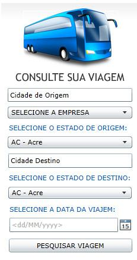
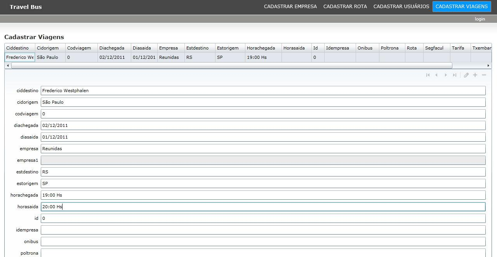
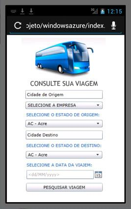

# 🚌 Travel Bus — TCC de Ciência da Computação (2011)

**Estudo e desenvolvimento de uma aplicação para consulta de viagens rodoviárias utilizando Silverlight**

Projeto acadêmico apresentado por **Maurício Andrade Pacheco** em novembro de 2011, como Trabalho de Conclusão do curso de **Ciência da Computação** da **Universidade Regional Integrada do Alto Uruguai e das Missões (URI), campus Frederico Westphalen/RS**.

> **Acervo histórico de portfólio.** Este repositório preserva a monografia, o artigo, a apresentação e imagens do sistema documentado à época. **O código-fonte original Silverlight (`.sln`, `.cs`, `.xaml`) não foi encontrado no material recuperado e não faz parte deste repositório.** Portanto, não se trata de uma aplicação executável ou mantida atualmente.

## 📖 Sobre o trabalho

O trabalho investigou a computação móvel e as aplicações ricas para a Internet (RIA), culminando em um protótipo para **consulta de viagens rodoviárias**. O passageiro podia pesquisar informações selecionando empresa, origem, destino e data da viagem. O estudo documenta ainda uma área administrativa para gestão de viagens, empresas, rotas e usuários.

O projeto foi desenvolvido no contexto tecnológico de **2011**, quando o Microsoft Silverlight e o Windows Azure eram opções exploradas para aplicações web e móveis.

## 🛠️ Tecnologias documentadas

- **Microsoft Silverlight**, C# e XAML
- **Visual Studio 2010** e **Microsoft Expression Blend**
- **WCF RIA Services** e **ADO.NET**
- **Microsoft SQL Server**
- **Windows Azure**, conforme descrito no trabalho acadêmico

As tecnologias acima são as relatadas na documentação, **não dependências atualmente executáveis neste acervo**.

## 🖼️ Telas originais (extraídas da monografia)

**Consulta de viagens**

**Área administrativa — cadastro de viagens**

**Demonstração em tablet (2011)**

## 📂 Material preservado

| Arquivo | Conteúdo |
| --- | --- |
| [`documentos/Monografia-TCC-2011.pdf`](documentos/Monografia-TCC-2011.pdf) | Monografia completa, 80 páginas |
| [`documentos/Monografia-TCC-2011.doc`](documentos/Monografia-TCC-2011.doc) | Documento original em Word (formato legado) |
| [`documentos/Artigo-TCC-2011.doc`](documentos/Artigo-TCC-2011.doc) | Artigo acadêmico |
| [`documentos/Apresentacao-TCC-2011.ppt`](documentos/Apresentacao-TCC-2011.ppt) | Slides da apresentação (PowerPoint legado) |
| [`imagens/`](imagens/) | Imagens originais extraídas da monografia |

**Nota sobre o banco:** o arquivo de origem continha um banco SQL Server legado (`.mdf` e `.ldf`). Por precaução, ele **não foi incluído na versão pública**, pois há estrutura de usuários e senhas e os registros não puderam ser auditados integralmente. O backup original permanece separado.

## 🕰️ Contexto histórico

O Microsoft Silverlight é uma tecnologia **descontinuada** e incompatível com a maioria dos navegadores atuais. Este repositório tem finalidade **acadêmica, histórica e de demonstração de trajetória profissional**, e não propõe seu uso em produção.

## 🎓 Informações acadêmicas

- **Autor:** Maurício Andrade Pacheco
- **Título:** *Estudo e desenvolvimento de uma aplicação para consulta de viagens rodoviárias utilizando Silverlight*
- **Curso:** Ciência da Computação
- **Instituição:** URI — Frederico Westphalen/RS
- **Ano:** 2011

---

**Portfólio profissional:** [github.com/mauricioapacheco](https://github.com/mauricioapacheco)

*Documentos e figuras preservados no contexto de um trabalho acadêmico de 2011; eventuais nomes de tecnologias, marcas e sistemas pertencem aos seus respectivos titulares.*
